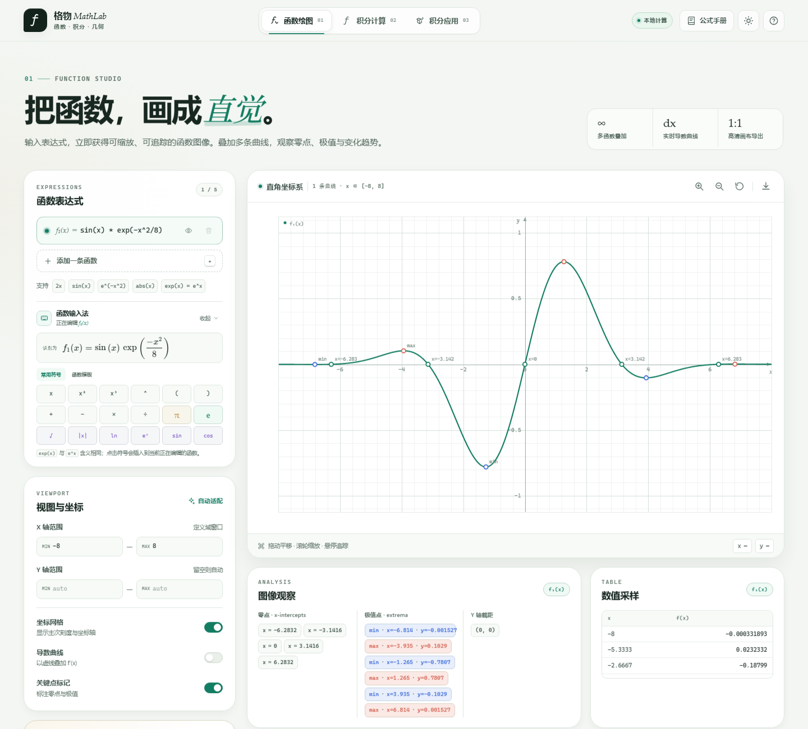
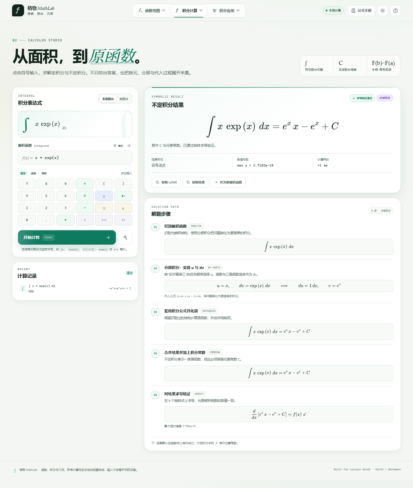
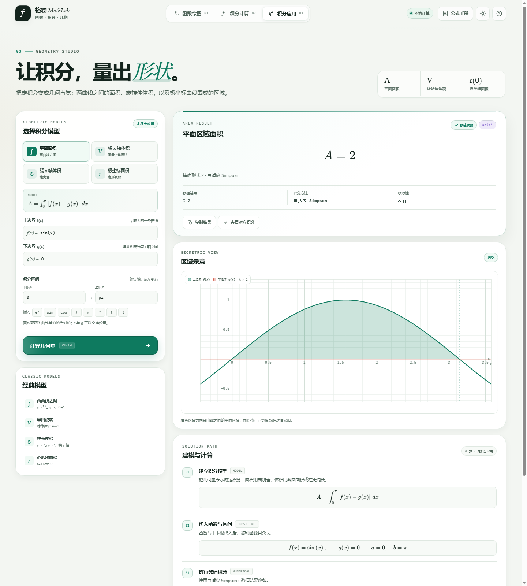

# 格物 MathLab · 函数、积分与几何工作台

一个完全在浏览器本地运行的数学工具网页。包含「函数绘图」「积分计算」「积分应用」三个模块，不依赖网络，打开 `index.html` 即可使用。







## 快速开始

直接双击 `index.html`，用现代浏览器（Edge / Chrome / Firefox）打开即可。

如果浏览器对本地字体加载有额外限制，也可以在项目目录运行一个静态服务器：

```powershell
python -m http.server 8123
```

然后访问 <http://localhost:8123>。

## 功能

### 01 · 函数绘图

- 最多同时绘制 5 条显函数曲线，颜色可切换、可隐藏
- 支持隐式乘法（`2x`、`2sin(x)`）与常用数学函数
- 内置函数输入法：可点击符号、函数与模板，实时显示识别后的公式
- 明确提示 `exp(x)` 与 `e^x` 等价，避免指数写法混淆
- 鼠标拖动平移、滚轮缩放、触屏双指缩放、键盘方向键移动
- 悬停追踪坐标与各函数取值
- 一阶导数虚线叠加
- 自动分析零点、极值点、Y 轴截距与数值采样表
- 自动适配 Y 轴范围，支持固定视窗
- 一键导出高清 PNG
- 常见函数图鉴：12 种基本函数的缩略图，点击可查看大图、定义域、值域、单调性、对称性与关键特征，并可直接绘制到画布

### 02 · 积分计算

- 不定积分与定积分切换
- 可点击的符号键盘：数字、运算符、函数、积分模板
- 自然书写与实时公式预览（KaTeX）
- 符号积分结果、定积分精确值与高精度近似值
- 逐步解题：识别结构、线性换元、分部积分、部分分式、牛顿–莱布尼茨公式、代入上下限、数值校验
- 对不定积分结果做抽样求导验证
- 对定积分结果做独立数值积分交叉校验
- 定积分区域可视化，可叠加原函数 `F(x)`
- 计算历史自动保存在浏览器本地
- 公式手册，可点击公式直接填入编辑器

### 03 · 积分应用

- 平面面积：两条曲线之间的区域，自动处理曲线上下交换
- 旋转体体积（绕 x 轴）：圆盘 / 垫圈法，带上下镜像的旋转体截面示意
- 旋转体体积（绕 y 轴）：柱壳法，要求区域位于 y 轴右侧
- 极坐标面积：`A = ½∫r(θ)² dθ`，支持 `theta` 与 `θ`
- 每个模型都显示积分公式、函数代入、数值积分方法、收敛性与几何示意图
- 自动识别常见精确值，如 `2`、`π/6`、`4π/3`、`3π/2`
- 可一键把几何模型对应的定积分送入「积分计算」模块

## 支持的计算范围

- 幂函数、指数函数、对数函数、三角/反三角函数、双曲函数、绝对值
- 线性换元、分部积分、简单有理函数（含部分分式与二次配方）
- 误差函数、正弦积分等特殊函数会直接以符号形式返回
- 没有初等原函数或超出本地引擎范围的表达式会给出明确提示
- 定积分发现区间内部奇点、数值积分不收敛时会提示可能发散，不强行给出不可靠结果

不定积分默认在函数定义域内成立，常数 `C` 表示任意常数。

## 输入语法

| 写法 | 含义 |
| --- | --- |
| `2x` / `2*x` | 乘法 |
| `x^3` | 幂 |
| `sqrt(x)` | 平方根 |
| `abs(x)` / `\|x\|` | 绝对值 |
| `e^x` / `exp(x)` | 自然指数（二者等价） |
| `ln(x)` / `log(x)` | 自然对数 |
| `pi` | 圆周率 |
| `theta` / `θ` | 极坐标极角（积分应用模块） |
| `sin(2x+pi/4)` | 线性内层三角函数 |
| `y = x^2` | 绘图时会自动去掉 `y =` |

## 键盘快捷键

| 快捷键 | 操作 |
| --- | --- |
| `Alt` + `1` | 函数绘图 |
| `Alt` + `2` | 积分计算 |
| `Alt` + `3` | 积分应用 |
| `Ctrl` / `Cmd` + `Enter` | 开始计算 |
| `Alt` + `T` | 明暗主题切换 |
| `Esc` | 关闭弹窗 |

绘图画布获得焦点后，方向键平移、`+` / `-` 缩放、`0` 重置视图、`F` 自动适配 Y 轴。

## 技术说明

- 页面为纯静态 HTML / CSS / JavaScript，无构建步骤
- 绘图使用 Canvas 2D 自行实现坐标系、采样、交互与区域渲染
- 表达式解析与数值计算：[math.js](https://mathjs.org/)
- 符号微积分：[Nerdamer](https://nerdamer.com/)
- 数学排版：[KaTeX](https://katex.org/)
- 三个库均已放入 `assets/vendor/`，可离线使用；许可证见同目录
- 用户输入与历史仅保存在浏览器 `localStorage`，不会上传到任何服务器

## 目录结构

```
├─ index.html
├─ assets
│  ├─ css/styles.css
│  ├─ js/math-core.js      # 解析、符号积分、数值积分、解题步骤
│  ├─ js/plotter.js        # Canvas 函数绘图与区域渲染
│  ├─ js/app.js            # 三个模块的界面与交互控制
│  └─ vendor                # 本地化的 math.js / Nerdamer / KaTeX
├─ docs                     # README 预览图
└─ README.md
```

## 已知限制

- 符号积分建立在 Nerdamer 之上，并额外补充了有理函数回退；非常规的特殊函数或高阶有理式可能无法给出初等闭式
- 定积分对内部奇点采用保守策略：检测到数值不收敛时会提示可能发散，而不是输出不可靠的数值
- 旋转体模块以数值积分为主，精确值仅对常见的有理数 / π 倍数进行识别
- 不处理复数域上的路径积分、多变量积分与广义函数
- 绘图只支持 `y = f(x)` 形式的显函数
